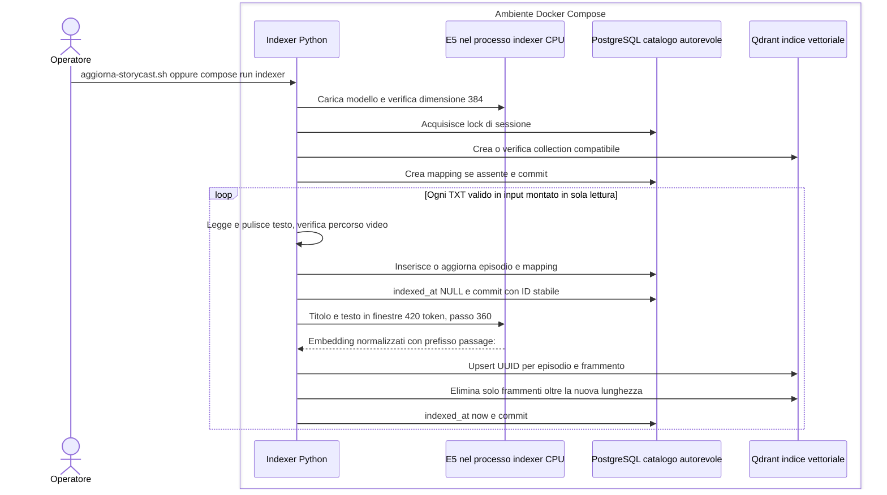
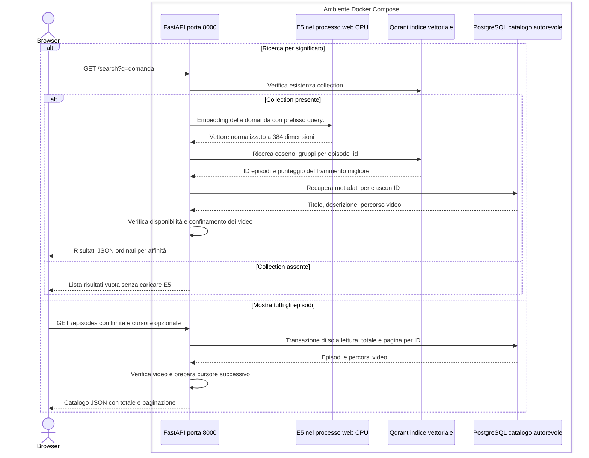

# Storycast AI Qdrant

Catalogo e ricerca semantica locale dei dialoghi di **Storycast**, con interfaccia web in italiano e riproduzione dei video già generati. Il progetto è indipendente da [Uraroga/storycast-docker](https://github.com/Uraroga/storycast-docker): ne legge `input/` e `output/` in sola lettura, senza modificare il generatore originale. Può usare anche una directory autonoma con lo stesso formato. Non genera video, non trascrive audio e non produce risposte con un LLM.

## Architettura

| Servizio | Ruolo |
|---|---|
| PostgreSQL | Fonte autorevole: episodi, testi, percorsi video e associazioni sorgente/ID. |
| Qdrant | Indice derivato `storycast_e5_small_v1`: vettori da 384 dimensioni, distanza coseno. |
| `web` | FastAPI e interfaccia sulla porta **8000**, ricerca, catalogo e streaming video HTTP Range. |
| `indexer` | Importazione manuale dei TXT, embedding CPU e aggiornamento dell'indice; profilo `tools`. |

Il modello è [`intfloat/multilingual-e5-small`](https://huggingface.co/intfloat/multilingual-e5-small), con revisione fissata nel Compose. Usa i prefissi `query: ` e `passage: ` e finestre di 420 token con passo 360. Il primo utilizzo scarica i pesi; il calcolo degli embedding avviene sempre localmente. Con la cache completa, `HF_HUB_OFFLINE=1` impedisce le richieste a Hugging Face per il caricamento del modello. La cache vive in un volume dedicato. Non servono chiavi API né GPU.

La **ricerca semantica** restituisce episodi distinti ordinati per affinità: il punteggio non è una probabilità. **Mostra tutti gli episodi** legge invece l'intero catalogo PostgreSQL, inclusi i record non indicizzati, con totale e paginazione per ID decrescente; funziona senza caricare il modello e senza consultare Qdrant.

## Come passano i dati

Docker Compose è l’ambiente di esecuzione: collega i servizi tramite la propria rete e conserva database e cache in volumi distinti. Il modello E5 è una libreria caricata nei processi Python di `web` e `indexer`, non un servizio separato. I TXT e i video restano nelle directory host montate in sola lettura.

### A. Indicizzazione manuale dei TXT



L’ID SQL viene quindi salvato **prima** degli embedding del singolo episodio. Il modello viene però caricato e verificato prima di aprire la sessione SQL. Qdrant conserva vettori e payload `episode_id`, `chunk`, `model_revision`; titoli, descrizioni e testi completi rimangono in PostgreSQL. Non memorizza copie dei video né il testo dei frammenti.

### B. Ricerca semantica e catalogo completo



È FastAPI a interrogare i database: il browser comunica soltanto con il servizio web. Il catalogo non usa E5 o Qdrant. La ricerca restituisce per impostazione predefinita fino a 5 episodi distinti (massimo 20 via API), senza soglia minima di affinità e senza generare risposte. Eventuali punti privi del corrispondente episodio SQL vengono omessi.

La riproduzione è una richiesta successiva del browser a `/video/ID`: FastAPI legge il percorso in PostgreSQL, lo verifica e serve il file già esistente. Un video assente non impedisce la consultazione del testo descrittivo.

## Installazione su Ubuntu

Procedura per una **nuova installazione**, su una macchina o VM separata dai servizi esistenti. Una sola directory diversa non garantisce isolamento: nomi progetto Compose, porte e immagini possono coincidere. Non copiare questi file sopra un'installazione funzionante. Servono Ubuntu con Docker Engine e plugin Compose, Git, Bash, curl, Python 3 e sha256sum. Installare Docker seguendo la [documentazione ufficiale Ubuntu](https://docs.docker.com/engine/install/ubuntu/). I digest e l'ambiente attuali sono stati usati su Linux amd64; altre architetture non sono verificate. Prevedere diversi GB di disco e RAM: web e indicizzatore possono usare fino a 3 GB ciascuno, oltre ai database.

Per installare il progetto:

```bash
git clone https://github.com/Uraroga/storycast-ai-qdrant.git
cd storycast-ai-qdrant
# Solo nella nuova copia: non sovrascrivere configurazioni esistenti.
cp -n compose.example.yaml compose.yaml
cp -n .env.example .env
chmod 600 .env
mkdir -p local/storycast/input local/storycast/output
```

Modificare `.env` con un editor: sostituire `POSTGRES_PASSWORD` con una password casuale lunga e impostare `STORYCAST_ROOT` sulla directory contenente `input/` e `output/`. Il valore dimostrativo usa `./local/storycast`; è possibile indicare una copia separata dei contenuti. L'UID 10001 del container deve poter leggere i file e attraversare le directory, senza aprire indiscriminatamente i permessi. Il repository non contiene dialoghi o video.

```bash
docker compose config --quiet
docker compose build web
docker compose up -d postgres qdrant
# Attendere che i database siano pronti: consultare ps e log.
docker compose ps
docker compose run --rm --no-deps indexer
docker compose up -d --no-deps web
```

Lo schema `initdb/001-episodes.sql` inizializza **solo un volume PostgreSQL nuovo**. La tabella di mapping viene creata dall'indicizzatore. Non occorre il database di Storycast originale. Cambiare le variabili `POSTGRES_*` non cambia credenziali o schema di un volume già inizializzato. Se le porte 5432, 6333 o 8000 sono occupate, scegliere una macchina isolata o adattare le pubblicazioni prima dell'avvio; non arrestare altri servizi.

Aprire `http://127.0.0.1:8000`. API: `/episodes`, `/search?q=domanda`, `/video/ID`, `/health`; documentazione interattiva FastAPI in `/docs`.

## Indicizzazione manuale e video

Mettere i dialoghi UTF-8 direttamente in `input/*.txt`. Le righe interamente racchiuse tra parentesi quadre (per esempio `[personaggio|tono]`), i template `MODELLO*`, i file vuoti e i symlink sorgente vengono ignorati. La corrispondenza video è:

- `input/esempio.txt` → `output/esempio/esempio_video.mp4`;
- `input/esempio-short.txt` → `output/esempio/esempio_short_video.mp4`.

Eseguire `./aggiorna-storycast.sh` o `docker compose run --rm --no-deps indexer` ogni volta che si aggiornano i testi o si aggiungono video. L'operazione **scrive** su PostgreSQL e Qdrant: riusa ID e UUID dei file già noti. Rinominare un TXT crea una nuova identità; eliminarlo non cancella automaticamente i record. Non c'è un watcher né un'integrazione automatica con il generatore.

I media sono letti in sola lettura; percorsi esterni e symlink che escono dalla directory autorizzata vengono rifiutati. HTTP Range permette lo spostamento nel video, ma non c'è transcodifica: i codec devono essere supportati dal browser.

## Accesso dalla LAN

Il modello pubblico espone il web su loopback. Per una LAN fidata configurare in `.env` `WEB_BIND_IP` con l'IP privato del server e `WEB_ALLOWED_NETWORKS` con loopback più la propria subnet CIDR. Dopo l'applicazione della configurazione sul proprio ambiente, aprire `http://IP_DEL_SERVER:8000`. I link video relativi usano la stessa origine. [Guida LAN e firewall](docs/ACCESSO_LAN.md).

## Test, backup e ripristino

Test isolati, senza collegamenti ai database e senza download del modello:

```bash
docker compose run --rm --no-deps -e WEB_ALLOWED_NETWORKS= indexer pytest -q
```

I test marcati `integration` sono esclusi per impostazione predefinita. `tests/test_catalog_sql.py` fa letture reali; `tests/test_integration.py` include **reindicizzazione con scritture** e richiede uno specifico corpus dimostrativo, non distribuito. Eseguirli solo su un ambiente di prova predisposto, con `pytest -o addopts= -m integration`. Gli script `smoke.py` e `verify_lan.py` dipendono anch'essi da episodi Docker/Kubernetes con video disponibili; non costituiscono un test generico di installazione vuota.

```bash
# Lettura del servizio della propria installazione
curl -fsS http://127.0.0.1:8000/health
# Operazioni amministrative da eseguire quando pianificate
./scripts/backup.sh
./scripts/verify-restore.sh backups/NOME_CARTELLA
```

Il backup crea un dump SQL e uno snapshot Qdrant con checksum, coordinandosi con l'indicizzatore mediante lock. **Crea dati persistenti e uno snapshot nel servizio Qdrant**. Include anche una copia del Compose locale. Non copia `.env`, sorgenti, video o cache: salvarli separatamente. La copia Compose può contenere dettagli privati o segreti se inseriti direttamente nella configurazione: proteggere l’intero backup. I backup contengono testi riservati; proteggerli e conservarne copie cifrate fuori macchina.

La verifica di ripristino crea database e volumi separati, senza porte host, importa i backup, confronta impronte SQL e conteggi e prova una ricerca vettoriale. Richiede l'immagine applicativa già costruita; arresta le copie e conserva i volumi. Non effettua un ripristino sopra la produzione. Per un recupero reale verificare prima una copia isolata e pianificare il passaggio dei client. [Guida operativa](docs/GUIDA.md) e [comandi](docs/COMANDI.md).

## Limitazioni e sicurezza

Non ci sono login, HTTPS, quote o limiti di frequenza. Tutti i client autorizzati dalla rete possono leggere l'intero catalogo e i video. Non esporre il servizio a Internet o tramite port forwarding. Qdrant non ha autenticazione nella configurazione fornita; PostgreSQL e Qdrant sono pubblicati solo su loopback. Il filtro IP applicativo non sostituisce firewall, autenticazione o isolamento di rete; una lista di reti vuota disabilita il filtro. Uvicorn ignora gli header proxy.

SQL e Qdrant non condividono una transazione: un errore può lasciare l'indice incompleto, riparabile rilanciando l'indicizzatore. Il lock coordina solo gli strumenti cooperanti. `/health` controlla SQL e Qdrant, non la qualità dell'indice. Il catalogo può funzionare anche con Qdrant indisponibile. Non usare `docker compose down -v` sui dati da conservare.

Le dipendenze sono fissate per riproducibilità, ma questo non garantisce assenza di vulnerabilità; prima di un'esposizione più ampia servono audit e aggiornamenti verificati. Non sono certificati carichi elevati, altre architetture o il playback su tutti i browser.

## Diagnostica in sola lettura

```bash
docker compose ps
docker compose logs --tail=100 web postgres qdrant
docker compose config --quiet
curl -fsS http://127.0.0.1:8000/health
curl -fsS 'http://127.0.0.1:8000/episodes?limit=1'
curl -fsS http://127.0.0.1:6333/collections
```

Una prima ricerca lenta può dipendere da download o caricamento di E5. Un catalogo consultabile con `/health` in errore può indicare Qdrant indisponibile. Nessun risultato può dipendere da una collection assente; un video mancante da percorso, mount o permessi. Consultare i log senza pubblicarne eventuali contenuti riservati. Questi controlli non indicizzano e non riparano i dati.

## Sviluppi possibili

Autenticazione, HTTPS, ruoli SQL separati, metriche dei tempi, valutazione della qualità su un corpus etichettato e prove di carico sono attività future. Anche watcher automatici, sincronizzazione delle cancellazioni e ricerca ibrida richiederebbero implementazioni dedicate. Non sono funzionalità disponibili oggi. Restano da collaudare installazione completa su una seconda macchina e compatibilità su altre architetture.

## Documentazione e licenza

[Architettura](docs/ARCHITETTURA.md) · [Catalogo](docs/CATALOGO.md) · [Guida](docs/GUIDA.md) · [Lezioni](docs/LEZIONI.md) · [Domande](docs/DOMANDE.md) · [Verifiche](docs/VERIFICHE.md).

Materiale di approfondimento revisionato:

- [Guida ragionata in Word](docs/pubblici/Guida_Storycast_AI_Qdrant_pubblica.docx).
- [Presentazione del progetto in PowerPoint](docs/pubblici/Storycast_AI_Qdrant_pubblica.pptx).

Le copie pubbliche omettono riferimenti all’installazione privata e metadati identificativi. Le prove storiche citate non sono benchmark né verifiche rieseguite durante questa revisione. I diagrammi Mermaid sopra e il codice costituiscono il riferimento per l’ordine delle operazioni; le slide sintetizzano i concetti.

Distribuito con [licenza MIT](LICENSE). Copyright © 2026 Sergio De Rossi (Uraroga). Le licenze di modelli, dipendenze e contenuti restano distinte.
