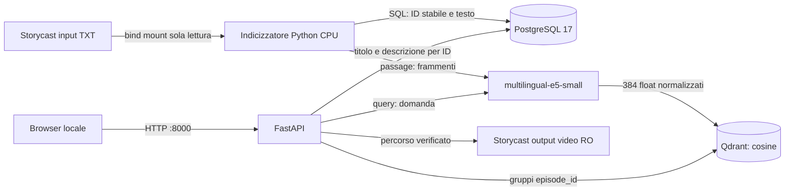
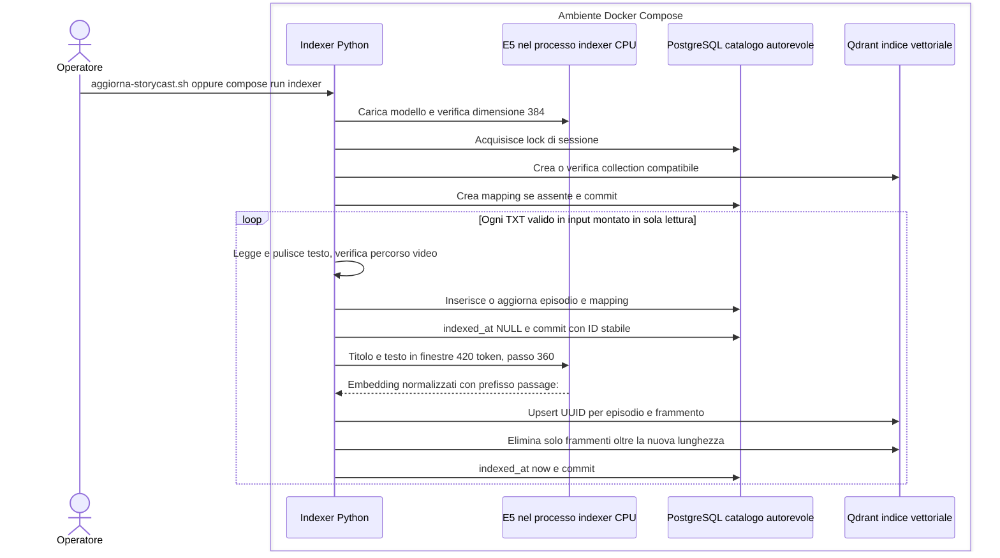
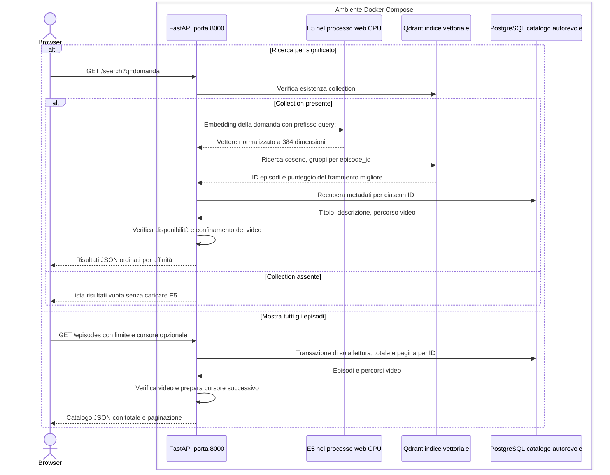

> Documentazione tecnica adattata per la distribuzione indipendente. Gli indirizzi `192.0.2.*` e `198.51.100.*` sono esempi non operativi: sostituirli con quelli della propria rete. Per una nuova installazione seguire prima il [README](../README.md); `compose.yaml` è locale, generato da `compose.example.yaml`. Le prove storiche non certificano una nuova installazione.

# Architettura e flussi



PostgreSQL è la fonte autorevole: conserva gli episodi e la tabella `episode_sources`, che associa un nome di file univoco a un `episode_id` univoco. Lo schema della tabella `episodes` preesistente non viene alterato. I record non associati a sorgenti non vengono sovrascritti dall’importazione. Qdrant è un indice ricostruibile, non il catalogo.

```mermaid
sequenceDiagram
  participant I as Indexer
  participant P as PostgreSQL
  participant Q as Qdrant
  I->>P: lock cooperativo + migrazione additiva
  I->>P: inserisci/aggiorna episodio; indexed_at NULL; commit
  I->>Q: upsert UUID deterministici (episode_id, chunk)
  I->>Q: elimina solo chunk oltre la nuova lunghezza
  I->>P: indexed_at now(); commit
```

Non c'è una transazione distribuita fra PostgreSQL e Qdrant. Se il processo si arresta, il catalogo può precedere l'indice; rilanciare l'indicizzatore ripara questa situazione. Durante l'aggiornamento una ricerca può vedere temporaneamente dati misti. `indexed_at NULL` segnala un aggiornamento incompleto. Il lock PostgreSQL serializza gli indicizzatori e il backup; non blocca modifiche manuali o strumenti che non rispettano il lock.

Gli UUID stabili impediscono duplicazioni a ogni esecuzione. Se un testo diventa più breve, vengono eliminati solo i suoi frammenti superflui. Rinominarlo genera una nuova identità: la cancellazione dei file sorgente non cancella episodi, scelta conservativa. Le versioni `-short` sono episodi distinti. I template `MODELLO*`, PPTX e file vuoti non entrano nel catalogo.

# Modello

È scelto `intfloat/multilingual-e5-small`, revisione immutabile `614241f622f53c4eeff9890bdc4f31cfecc418b3`: 12 strati, vettori 384, multilingue e adatto all'italiano. I prefissi `query: ` e `passage: ` seguono le istruzioni ufficiali. CPU PyTorch, nessuna GPU o API esterna. Fonti: [model card](https://huggingface.co/intfloat/multilingual-e5-small), [punti Qdrant](https://qdrant.tech/documentation/concepts/points/).

Il modello ha un limite di 512 token. Si usano finestre da 420 token con passo 360, lasciando spazio al prefisso e ai token speciali. I vettori sono normalizzati e confrontati mediante coseno. Il punteggio misura affinità, non probabilità: la demo restituisce i migliori episodi anche per una domanda fuori tema. Non genera risposte e non usa un LLM.

Il modello occupa indicativamente circa 470 MB per i pesi; riservare 1–2 GB RAM per processo, fino a 3 GB col limite configurato. Sono stime, dipendenti da testo e batch; vedere le misure effettive in VERIFICHE.md. Web e indexer sono processi distinti e caricano ciascuno il modello; la cache su volume evita download ripetuti. Una cache completa permette il caricamento offline con `HF_HUB_OFFLINE=1`; senza questa opzione possono avvenire richieste di metadati anche in seguito.

# Docker

Un'immagine è un pacchetto di filesystem e istruzioni. Un container è un processo isolato avviato da quell'immagine. Un servizio Compose descrive come avviare un tipo di container. Un volume conserva dati anche quando un container viene sostituito. Un bind mount espone una cartella host: qui `input/` e `output/` sono montate in sola lettura.

Nella rete Compose i nomi `postgres` e `qdrant` sono indirizzi DNS. Dentro Python `localhost` indica Python stesso; non PostgreSQL. Il browser usa invece la porta host `192.0.2.10:8000`; vedere [ACCESSO_LAN.md](ACCESSO_LAN.md) per filtro di rete e rollback. PostgreSQL e Qdrant restano sulle porte locali preesistenti, senza autenticazione Qdrant: non esporle a Internet.

I container applicativi girano come UID 10001, filesystem in sola lettura, capability rimosse, massimo 2 CPU e 3 GB RAM. Solo cache e `/tmp` sono scrivibili. I segreti sono letti da `.env`, mai incorporati nell'immagine. La demo condivide l'utente SQL esistente: su installazioni multiutente creare ruoli SQL separati con privilegi minimi prima di esporre il servizio.

# Preservazione dei servizi

Le immagini originarie erano tag mobili (`postgres:17` e `qdrant/qdrant:latest`): sono state risolte ai digest già installati, senza cambiare versione effettiva. Si è usato l'avvio selettivo dei nuovi servizi per non ricreare quelli esistenti. I nomi `postgres_data` e `qdrant_data` restano invariati. Non viene eseguito alcun comando di arresto o aggiornamento sui progetti altri servizi e altro-servizio-llm.


## Catalogo SQL e caricamento differito

`GET /episodes` legge esclusivamente PostgreSQL: totale esatto, pagina ordinata per ID decrescente, cursore `before_id`, link video validati. Non chiama Qdrant né il modello. Il browser offre una vista catalogo separata e il ritorno alla ricerca. Il modello web è ora caricato solo dalla prima ricerca semantica, non all'avvio FastAPI. Dettagli e limiti di ordinamento/paginazione: [CATALOGO.md](CATALOGO.md).

## Flussi verificati

Il [README](../README.md#come-passano-i-dati) presenta le infografiche. Le sequenze qui sotto documentano le interazioni tra i componenti.

### Indicizzazione manuale dei TXT



Il modello viene caricato e verificato prima di aprire la sessione SQL. Il commit dell’episodio precede la generazione dei suoi embedding. Qdrant conserva i vettori e il payload `episode_id`, `chunk`, `model_revision`. Titoli, descrizioni e trascrizioni complete rimangono in PostgreSQL. I video risiedono sul filesystem.

### Ricerca semantica e catalogo completo



Il browser comunica con FastAPI, che interroga i database. La ricerca restituisce fino a 5 episodi distinti per impostazione predefinita, con un massimo di 20 via API e senza una soglia minima di affinità. I punti senza un episodio SQL corrispondente vengono omessi.

La riproduzione richiede una chiamata successiva a `/video/ID`. FastAPI legge il percorso in PostgreSQL, lo verifica e trasmette il file esistente. Se il video è assente, la descrizione dell’episodio resta consultabile.
